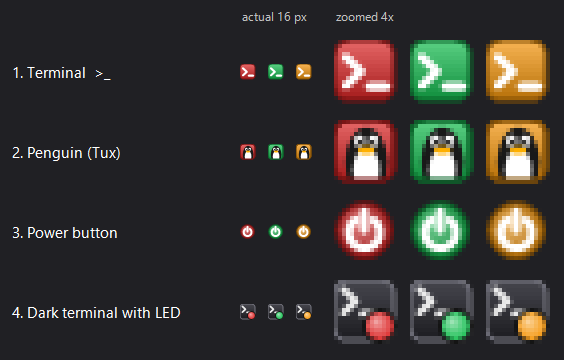

<p align="center">
  
</p>

<h1 align="center">WSL Tray</h1>

A tiny glowing button in the Windows notification area that shows at a glance whether **WSL** is running, and turns it on or off with one click. Linux only uses RAM while you actually need it.

| Off | On | Shutting down |
|:---:|:---:|:---:|
|  |  |  |

- **Red**: WSL is off and uses no RAM.
- **Green**: a Linux distribution is running. The tooltip shows which one and how much RAM the VM is using.
- **Amber**: WSL is starting or stopping, or no distro is running but the VM is still in memory. The VM shuts down by itself after `vmIdleTimeout`.

## What is WSL?

**WSL (Windows Subsystem for Linux)** is a Microsoft component of Windows. It runs real Linux distributions such as Ubuntu, Debian, Fedora or openSUSE directly on Windows, with no dual boot and no separate virtual machine manager like VirtualBox or VMware. You get a Linux shell, Linux command-line tools and package managers (`apt`, `dnf`, …) and you can run Linux programs alongside your Windows apps. Your Windows files are available under `/mnt/c`. Developers use it heavily for web development, Docker, Python, data science and anything that is easier on Linux.

There are two flavours:

| | WSL 1 | WSL 2 (default today) |
|---|---|---|
| How it works | Translates Linux system calls into Windows ones | Runs a **real Linux kernel** in a lightweight virtual machine |
| Compatibility | Good, not complete | Full (Docker, systemd, …) |
| Memory | No VM | The VM reserves RAM while it runs. It appears as **`vmmemWSL`** in Task Manager |

**WSL Tray is designed for WSL 2.** With WSL 2, the VM can use up to **50% of your physical RAM** by default (for example 8 GB on a 16 GB laptop). Once Linux has grabbed memory, for example for its file cache, it often doesn't give it back to Windows until WSL is shut down. That's why it helps to see at a glance whether WSL is on, and to switch it off when you're not using it.

### Which machines have it?

WSL is **built into Windows, but not enabled out of the box**. It is available on:

- **Windows 11**: every edition, Home included.
- **Windows 10**: version 1903 (build 18362.1049) or later for WSL 2. The one-command install (`wsl --install`) needs version 2004 (build 19041) or later.
- **Windows Server 2022** and later. Windows Server 2019 only supports WSL 1.
- Both **x64** (Intel/AMD) and **ARM64** PCs, such as Snapdragon-based laptops.

WSL 2 also needs **hardware virtualization** (Intel VT-x or AMD-V) enabled in the BIOS/UEFI. It is on by default on most modern PCs. WSL 2 uses Windows' lightweight *Virtual Machine Platform* rather than full Hyper-V, which is why it works on Home editions too. WSL is not available in Windows S mode or on 32-bit Windows. Inside a virtual machine it only works if the host allows nested virtualization.

### Do I have it? How do I install it?

```powershell
wsl --status        # is WSL installed, and which version is the default?
wsl -l -v           # installed distributions, their state and WSL version
```

If WSL isn't installed, open PowerShell **as administrator**, run the command below and restart Windows:

```powershell
wsl --install       # installs WSL 2 and Ubuntu
```

See Microsoft's [WSL documentation](https://learn.microsoft.com/windows/wsl/) for more details.

## Usage

- **Left click**: turns WSL on or off. It **always asks for confirmation** first, and the default button is *No*.
- **Right click**: a menu with the status, Turn on, Turn off, Open Linux terminal, Icon style, Start with Windows and Exit.
- **Exit** only closes the icon. WSL stays as it is.

To turn WSL on, WSL Tray starts a hidden `sleep infinity` process in the default distribution so the distro stays up. To turn it off, it runs `wsl --shutdown`, which stops every distribution and the VM and gives the RAM back to Windows.

The status refreshes every 3 seconds using `wsl -l --running -q` and by checking for the `vmmemWSL` process.

### Icon styles

You can pick the icon style from the right-click menu → **Icon style**. Your choice is remembered in `HKCU\Software\WslTray`.



### Languages

The interface follows the Windows display language: **English** (default), Italian, Spanish, French, German and Portuguese. Any other language falls back to English. To force a language, use `WslTray.exe --lang it`.

To add a translation, copy the English block in [`src/Strings.cs`](src/Strings.cs), translate it and send a pull request.

## Download

Grab `WslTray.exe` (or the zip) from the [latest release](https://github.com/robertobissanti/wsl-tray/releases/latest) and run it. Nothing needs installing.

The executable isn't code-signed, so Windows SmartScreen may show *"Windows protected your PC"* the first time you run it. Click **More info → Run anyway**. If you'd rather not, build it from source yourself (see below). Each release lists the SHA-256 checksums of its files.

## Build

There is nothing to install. The build uses the C# compiler that ships with Windows (.NET Framework 4.x).

```powershell
.\build.ps1          # creates bin\WslTray.exe
.\bin\WslTray.exe
```

To start it at sign-in, tick **Start with Windows** in the menu. The setting is written to `HKCU\...\Run`, so no admin rights are needed.

`WslTray.exe --render <folder>` saves the icons as PNG files and builds the comparison sheet shown above.

## Tip: cap WSL's memory

With no configuration, WSL 2 can use up to 50% of your RAM. Here is an example `%USERPROFILE%\.wslconfig`:

```ini
[wsl2]
memory=6GB
swap=4GB
vmIdleTimeout=60000

[experimental]
autoMemoryReclaim=gradual
sparseVhd=true
```

## Requirements

- Windows 10/11 with WSL 2 installed (see [Which machines have it?](#which-machines-have-it))
- .NET Framework 4.x (already included in Windows)

## License

[BSD 3-Clause](LICENSE) © 2026 Roberto Bissanti
